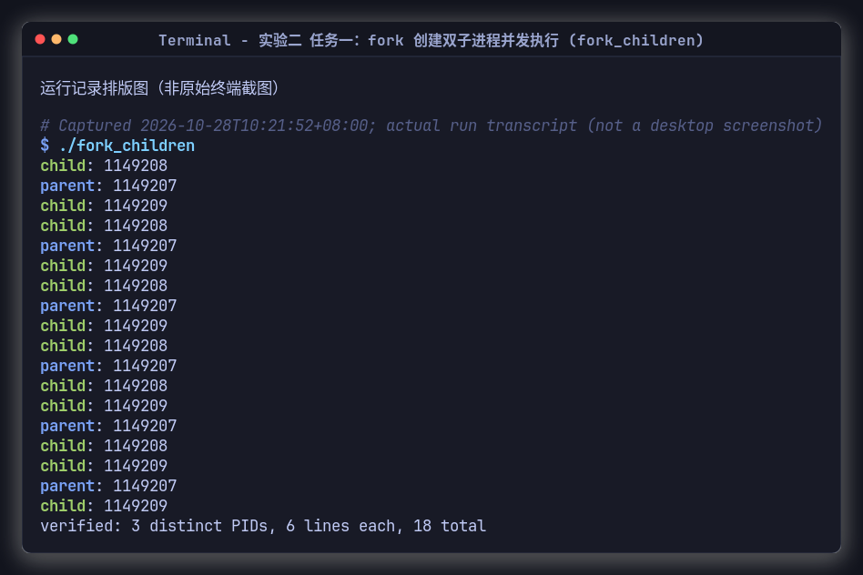
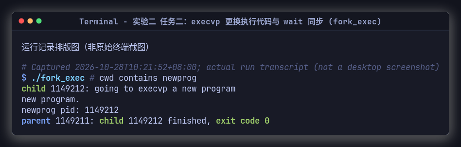

# 操作系统原理 实验报告

* **实验名称**：实验二：进程控制
* **姓名**：（填写姓名）　**学号**：（填写学号）　**日期**：2026-10-25
* **维护复测时间**：2026-11-26T19:44:23+08:00
* **复测环境**：Linux 7.3.5-2-cachyos x86_64 GNU/Linux；gcc (GCC) 16.2.1 20260810

> 本文由模板、当前源码和实际运行记录生成。图片为运行记录排版图，非原始终端截图；提交前须补充本人终端原始截图并填写个人信息。

## 一、实验过程（20 分）

第一个程序用两次 `fork()` 创建恰好两个子进程，父进程与两个子进程各打印六次自己的身份和 PID。子进程完成后直接退出，不再执行第二次创建逻辑，因而不会形成四个进程。行缓冲及短暂 `usleep()` 用于方便观察交错，不强制规定三者的执行顺序。

第二个程序创建一个子进程，由它用 `execvp()` 执行同一目录下的 `newprog`，新程序显示要求的 `new program.`，并额外打印 PID 以便核对。父进程用 `wait()` 等待结束并检查退出类型与状态。本次补齐创建失败、等待被信号中断及 exec 失败的处理；失败状态也会反映到主程序返回值中。

## 二、实验详细操作步骤与程序清单（30 分）

以仓库根目录为当前目录：

```sh
make all
./build/lab2/fork_children
(cd build/lab2 && ./fork_exec)     # ./newprog 相对当前工作目录查找
make record
make reports
```

单独编译时，先在同一输出目录编译 `newprog.c` 和 `fork_exec.c`，再进入该目录执行。统一编译参数为 `-std=gnu17 -Wall -Wextra -Wpedantic -Wconversion -Werror -O2 -g`。

### `src/lab2/fork_children.c`

```c
/* 实验二 任务一：fork 创建两个子进程，父子进程重复显示自己的标识数 */
#include <stdio.h>
#include <stdlib.h>
#include <unistd.h>
#include <sys/types.h>
#include <sys/wait.h>
#include <errno.h>

#define LOOP 6 /* 每个进程重复显示的次数 */

/* wait 返回任意已结束的子进程，并不保证创建顺序。 */
static int reap(int count)
{
    int failed = 0;
    while (count-- > 0)
    {
        int status;
        pid_t done;
        do 
        { 
            done = wait(&status); 
        } 
        while (done < 0 && errno == EINTR);

        if (done < 0)
        {
            perror("wait");
            return 1;
        }
        if (!WIFEXITED(status) || WEXITSTATUS(status) != 0)
            failed = 1;
    }
    return failed;
}

int main(void)
{
    pid_t pid;

    /* 把 stdout 设为行缓冲：输出重定向到管道/文件时也逐行刷新，
       便于观察三个进程并发执行时输出交错出现的现象 */
    setvbuf(stdout, NULL, _IOLBF, 0);

    pid = fork(); /* 创建第一个子进程 */
    if (pid < 0)
    {
        perror("fork");
        return 1;
    }
    if (pid == 0)
    {
        for (int i = 0; i < LOOP; i++)
        {
            printf("child: %d\n", getpid());
            usleep(100000); /* 睡 100ms，便于观察交错，不保证轮流执行 */
        }
        exit(0);
    }

    pid = fork(); /* 创建第二个子进程 */
    if (pid < 0)
    {
        perror("fork");
        (void)reap(1); /* 第二次创建失败时仍回收已有子进程 */
        return 1;
    }
    if (pid == 0)
    {
        for (int i = 0; i < LOOP; i++)
        {
            printf("child: %d\n", getpid());
            usleep(150000); /* 睡 150ms，与另一子进程错开节奏 */
        }
        exit(0);
    }

    /* 父进程重复显示 "parent:" 与自己的标识数 */
    for (int i = 0; i < LOOP; i++)
    {
        printf("parent: %d\n", getpid());
        usleep(120000);
    }

    return reap(2); /* 回收两个子进程并检查状态 */
}
```

### `src/lab2/newprog.c`

```c
/* 实验二 任务二：新的执行代码，由子进程通过 execvp 装入 */
#include <stdio.h>
#include <unistd.h>

int main(void)
{
    printf("new program.\n");
    printf("newprog pid: %d\n", getpid()); /* 与 exec 前的子进程 PID 对照 */
    return 0;
}
```

### `src/lab2/fork_exec.c`

```c
/* 实验二 任务二：子进程 execvp 更换执行代码，父进程 wait 等待并显示子进程标识符 */
#include <stdio.h>
#include <stdlib.h>
#include <unistd.h>
#include <sys/types.h>
#include <sys/wait.h>
#include <errno.h>

int main(void)
{
    pid_t pid;
    int status;

    pid = fork(); /* 创建子进程 */
    if (pid < 0)
    {
        perror("fork");
        return 1;
    }
    if (pid == 0)
    {
        /* 子进程：打印一行后用 execvp 把当前进程映像替换为 ./newprog。
           execvp 成功后原代码不再执行，只有失败才会返回 */
        printf("child %d: going to execvp a new program\n", getpid());
        /* exec 前必须刷新 stdio 缓冲：execvp 会整个替换进程映像，
           尚未写到管道/文件的缓冲数据会被直接丢弃 */
        if (fflush(stdout) == EOF)
        {
            perror("fflush");
            _exit(1);
        }
        char *argv[] = {"newprog", NULL};
        execvp("./newprog", argv);
        perror("execvp"); /* 只有 execvp 出错才会执行到这里 */
        _exit(127);
    }

    /* 父进程：wait 阻塞等待子进程结束，结束后显示子进程标识符 */
    pid_t cpid;
    do { cpid = wait(&status); } while (cpid < 0 && errno == EINTR);
    if (cpid < 0)
    {
        perror("wait");
        return 1;
    }
    if (WIFEXITED(status))
    {
        printf("parent %d: child %d finished, exit code %d\n",
               getpid(), cpid, WEXITSTATUS(status));
        return WEXITSTATUS(status);
    }
    if (WIFSIGNALED(status))
        fprintf(stderr, "child %d terminated by signal %d\n", cpid, WTERMSIG(status));
    return 1;
}
```

## 三、实验结果及分析（30 分）

### 1. 创建两个子进程



```text
# Captured 2026-11-26T19:44:23+08:00; actual run transcript (not a desktop screenshot)
$ ./fork_children
child: 79576
parent: 79575
child: 79577
child: 79576
parent: 79575
child: 79577
child: 79576
parent: 79575
child: 79576
child: 79577
parent: 79575
child: 79576
child: 79577
parent: 79575
child: 79576
child: 79577
parent: 79575
child: 79577
verified: 3 distinct PIDs, 6 lines each, 18 total
```

完整记录包含一个父 PID、两个不同的子 PID，每个各六行，共十八行。三者并发推进，输出顺序不固定；重复运行可能得到不同顺序，也可能恰好相同，不能要求每次都不同。两个 `wait()` 回收的是任意先结束的子进程，并非依次保证回收“第一个创建”“第二个创建”的子进程。第二次 `fork()` 失败时，也会回收第一个已创建的子进程。

### 2. 替换进程映像与等待



```text
# Captured 2026-11-26T19:44:23+08:00; actual run transcript (not a desktop screenshot)
$ ./fork_exec # cwd contains newprog
child 79604: going to execvp a new program
new program.
newprog pid: 79604
parent 79603: child 79604 finished, exit code 0
```

exec 前提示中的子 PID 与 `newprog pid` 相同，直接验证 PID 未变；父进程最后显示同一子 PID 和退出码 0。新程序保留了题目要求的输出。回归测试另在不含 `newprog` 的目录运行，实际确认 `execvp()` 报错、子进程以 127 退出，父进程也返回 127，而非误报成功。

### 3. 思考题

**（1）fork 如何创建进程？**

内核创建新的进程管理结构和 PID，使子进程从调用返回处继续执行。父分支得到子 PID，子分支得到 0，失败返回 -1。现代 Linux 通常对普通私有可写映射采用写时复制，避免立即复制全部物理页；共享映射不因此变成私有副本。描述符表被复制，但对应描述符引用同一个打开文件描述（open file description），例如共享文件偏移，不能笼统认为所有资源都完全独立。

**（2）子进程的入口在哪里？**

从用户程序视角，子进程从 `fork()` 的返回处继续，不从 `main()` 开头重跑。返回值为 0，随后进入子分支；首次实际获得 CPU 的先后不由代码中的父子身份决定。

**（3）execvp 如何更换代码？**

`execvp()` 是 exec 家族的库接口，在 Linux 上通常最终使用 `execve()` 等系统调用。参数带斜杠时按路径定位，否则搜索 PATH。成功后替换进程映像，PID 保持不变，并从新可执行文件的入口开始，经加载器/运行库启动流程后通常进入 C 的 `main()`，不是直接跳到 `main()`。成功不返回；失败返回 -1，原程序才继续执行错误处理。旧 stdio 缓冲不会由 exec 自动刷新，因此本程序在 exec 前检查 `fflush(stdout)`。

**（4）多进程与单进程实现有何不同？**

相较单进程单线程的顺序实现，多进程可独立调度，具备在多核并行、隔离地址空间及分担阻塞的能力，但需要 IPC、同步和额外资源管理。隔离能限制一些内存错误的影响，却不能保证共享文件、共享内存或服务依赖完全不受其他进程故障影响。单进程也可以使用多线程、异步 I/O 和事件循环，并非一定只能顺序执行或不能利用多核。性能优劣要结合任务与通信开销判断。

## 四、疑难小结（20 分）

1. 路径按当前工作目录解释，不按 `fork_exec` 二进制所在目录解释；测试覆盖了缺少新程序的实际失败情况。
2. `wait()` 可能返回 -1/EINTR，应重试；只有 `WIFEXITED` 为真才读取 `WEXITSTATUS`，被信号终止时应使用 `WIFSIGNALED/WTERMSIG`。
3. exec 前打印要刷新；fork 前若有未刷新输出，父子可能分别刷新重复副本。此处保留显式处理，不虚构曾经丢失输出的调试历史。
4. 这组程序表明进程与程序并非一一固定对应：fork 增加进程，exec 不增加进程而替换它执行的程序，wait 负责等待和回收。
