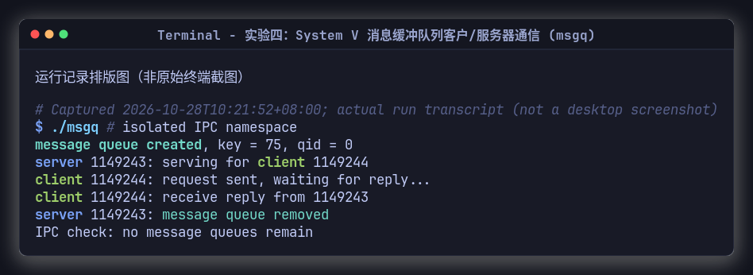

# 操作系统原理 实验报告

* **实验名称**：实验四：进程通信（二）
* **姓名**：（填写姓名）　**学号**：（填写学号）　**日期**：2026-10-25
* **维护复测时间**：2026-11-26T19:44:23+08:00
* **复测环境**：Linux 7.3.5-2-cachyos x86_64 GNU/Linux；gcc (GCC) 16.2.1 20260810

> 图片为真实运行记录的排版图，并非原始终端截图；提交前需补本人终端的原始截图和个人信息。程序清单由当前源码同步生成。

## 一、实验过程（20 分）

父进程先创建关键字为 75 的 System V 消息队列，再创建子进程。子进程发出类型 1、正文为自己 PID 的请求；父进程接收后显示 `serving for client` 和子 PID，再发出类型为子 PID、正文为父 PID 的应答。子进程按自己的 PID 接收应答，显示 `receive reply from` 和父 PID，父进程等待其结束并撤销队列。

本次把入口“删除已有 key=75 队列”的逻辑改为 `IPC_CREAT | IPC_EXCL | 0600` 排他创建。队列已存在就报错退出，原对象及消息保持不变；不能为方便重复运行而删除其他实例的资源。收发均检查返回值，对端 PID 按准确长度和内容核对；等待与收发对 EINTR 做处理，并设置约五秒的交互保护超时，避免对端失败后无限等待。这个超时由程序的 alarm 与信号处理实现，不是 System V 队列自带的超时参数。

## 二、实验详细操作步骤与程序清单（30 分）

在仓库根目录中执行：

```sh
make all
unshare --user --map-root-user --ipc sh -c './build/lab4/msgq; ipcs -q'
make record
make reports
```

复测在独立 IPC 命名空间进行，不接触主机上已有的 key=75 队列。如果直接运行时遇到 EEXIST，应先核实队列归属和是否仍被使用；本程序不自动 `ipcrm`。只能在明确确认属于自己的废弃对象时人工清理。

### `src/lab4/msgq.c`

```c
/* 实验四：key=75，类型 1 请求；类型=子 PID 应答。仅删除本次创建的队列。 */
#define _POSIX_C_SOURCE 200809L
#include <errno.h>      /* errno 和 EINTR、ESRCH 等错误码 */
#include <signal.h>     /* sigaction、SIGALRM、SIGTERM */
#include <stdio.h>      /* printf、perror、snprintf */
#include <stdlib.h>
#include <string.h>     /* memcmp */
#include <unistd.h>     /* fork、getpid、alarm */
#include <sys/wait.h>   /* waitpid 以及 WIFEXITED 等宏 */
#include <sys/msg.h>    /* System V 消息队列相关接口 */

#define MSGKEY 75 /* 消息队列的唯一键值，用于创建和定位该队列 */
#define TIMEOUT 5 /* 对端故障时不永久阻塞；不是消息队列自带的超时机制 */

struct msgform
{
    long mtype; /* 表示消息类型，用于接收方筛选消息。 */
    char mtext[1024]; /* 表示消息内容。 */
};

static volatile sig_atomic_t expired; /* 表示是否超时  0表示未超时，1表示已超时 */
static void on_alarm(int sig)
{
    /* 信号处理函数只修改标志，不在信号处理期间执行复杂操作。 */
    (void)sig;
    expired = 1;
    alarm(1); /* 再次唤醒，避免信号恰在进入阻塞调用前送达而丢失唤醒 */
}

/* qid：消息队列id type：消息类型 pid：要发送的进程ID */
static int send_pid(int qid, long type, pid_t pid)
{
    struct msgform msg = {.mtype = type};
    /* 消息正文使用字符串保存 PID，便于发送端和接收端进行严格校验。 */
    int len = snprintf(msg.mtext, sizeof(msg.mtext), "%ld", (long)pid);
    /* snprintf 会自动写入字符串结束符，len 不包含最后的 '\0'。 */
    if (len < 0 || (size_t)len >= sizeof(msg.mtext))
        return -1;
    int rc;
    /* msgsnd 的长度只计算 mtext，不包括消息结构开头的 mtype。 */
    do { rc = msgsnd(qid, &msg, (size_t)len + 1, 0); }
    /* 队列暂时不可用时可能被 SIGALRM 打断；未超时则继续尝试。 */
    while (rc < 0 && errno == EINTR && !expired);
    if (rc < 0)
        perror("msgsnd");
    return rc;
}

/* 本例仅有一对父子进程，严格核对正文长度、结束符及对端 PID。 */
static int receive_pid(int qid, long type, pid_t expected)
{
    struct msgform msg;
    ssize_t n;
    /* msgrcv 只接收指定类型的消息；消息类型必须是正数。 */
    do { n = msgrcv(qid, &msg, sizeof(msg.mtext), type, 0); }
    /* 没有匹配消息时会阻塞；被普通信号打断且未超时则重新等待。 */
    while (n < 0 && errno == EINTR && !expired);
    if (n < 0)
    {
        perror("msgrcv");
        return -1;
    }
    /* 接收内容应当是 expected 对应的十进制 PID。 */
    char text[32];
    int len = snprintf(text, sizeof(text), "%ld", (long)expected);
    /* len + 1 包含字符串结束符，必须与发送时的长度完全一致。 */
    /* 同时检查长度和正文，避免收到不属于当前通信双方的消息。 */
    if (len < 0 || (size_t)len >= sizeof(text) || n != len + 1 ||
        memcmp(msg.mtext, text, (size_t)len + 1) != 0)
    {
        fprintf(stderr, "invalid PID message\n");
        return -1;
    }
    return 0;
}

int main(void)
{
    /*
     * 先注册 SIGALRM 处理函数。
     * 后续的消息收发和 waitpid 可能阻塞，alarm 用于避免无限等待。
     */
    struct sigaction sa = {0};
    sa.sa_handler = on_alarm;
    /* 不设置 SA_RESTART，使 SIGALRM 能够打断阻塞系统调用。 */
    sigemptyset(&sa.sa_mask);
    if (sigaction(SIGALRM, &sa, NULL) < 0)
    {
        perror("sigaction");
        return 1;
    }
    /* 使用行缓冲，确保父子进程的状态信息及时输出。 */
    setvbuf(stdout, NULL, _IOLBF, 0);

    /*
     * 创建本次运行专用的消息队列。
     * IPC_EXCL 防止误用同 key 的旧队列，0600 只允许当前用户读写。
     */
    int qid = msgget(MSGKEY, IPC_CREAT | IPC_EXCL | 0600);
    if (qid < 0)
    {
        perror("msgget (existing queue is left untouched)");
        return 1;
    }
    printf("message queue created, key = %d, qid = %d\n", MSGKEY, qid);
    /* 保存父进程 PID，子进程会用它验证应答消息的发送者。 */
    pid_t parent = getpid();
    /* fork 后父子进程共享该消息队列，但各自拥有独立的执行流。 */
    pid_t pid = fork();
    int rc = 1;
    if (pid < 0)
    {
        /* fork 失败时没有子进程，但已创建的消息队列仍需删除。 */
        perror("fork");
        goto cleanup;
    }

    if (pid == 0)
    {
        /*
         * 子进程作为客户端：
         * 发送 type=1、正文为自身 PID 的请求，
         * 再接收 type=自身 PID 的服务器应答。
         */
        alarm(TIMEOUT);
        if (send_pid(qid, 1L, getpid()) < 0)
            _exit(1);
        printf("client %d: request sent, waiting for reply...\n", getpid());
        if (receive_pid(qid, (long)getpid(), parent) < 0)
            _exit(1);
        printf("client %d: receive reply from %d\n", getpid(), parent);
        _exit(0);
    }

    /*
     * fork 返回子进程 PID，说明当前处于父进程分支。
     * 父进程作为服务器，接收 type=1 的请求，
     * 再向对应的子进程 PID 发送应答。
     */
    alarm(TIMEOUT);
    if (receive_pid(qid, 1L, pid) < 0)
        goto cleanup;
    printf("server %d: serving for client %d\n", getpid(), pid);
    if (send_pid(qid, (long)pid, getpid()) < 0)
        goto cleanup;

    int status;
    pid_t done;
    /*
     * 等待子进程结束并保存退出状态。
     * 如果只是被信号打断且尚未超时，则继续等待。
     */
    do { done = waitpid(pid, &status, 0); }
    while (done < 0 && errno == EINTR && !expired);
    if (done < 0)
    {
        perror("waitpid");
        goto cleanup;
    }
    /* 子进程已被回收，清理阶段不应再次向它发送信号。 */
    pid = -1;
    /* 只有子进程正常退出且返回 0，父进程才报告通信成功。 */
    rc = !WIFEXITED(status) || WEXITSTATUS(status) != 0;

cleanup:
    /*
     * 统一清理入口：通信成功或任意一步失败，
     * 都必须取消定时器并删除本次创建的消息队列。
     */
    alarm(0);
    if (msgctl(qid, IPC_RMID, NULL) < 0)
    {
        perror("msgctl IPC_RMID");
        rc = 1;
    }
    else
        printf("server %d: message queue removed\n", getpid());
    if (pid > 0)
    {
        /* 出错时子进程可能仍在阻塞，先终止它，再回收其进程资源。 */
        if (kill(pid, SIGTERM) < 0 && errno != ESRCH)
            perror("kill child");
        /* waitpid 被信号中断时继续等待，避免留下僵尸进程。 */
        while (waitpid(pid, NULL, 0) < 0)
        {
            if (errno != EINTR)
            {
                perror("waitpid cleanup");
                break;
            }
        }
    }
    return rc;
}
```

## 三、实验结果及分析（30 分）

### 1. 请求与应答



```text
# Captured 2026-11-26T19:44:23+08:00; actual run transcript (not a desktop screenshot)
$ ./msgq # isolated IPC namespace
message queue created, key = 75, qid = 0
client 79655: request sent, waiting for reply...
server 79654: serving for client 79655
client 79655: receive reply from 79654
server 79654: message queue removed
IPC check: no message queues remain
```

请求类型固定为 1，正文为子 PID；应答类型为子 PID，正文为父 PID。记录中的服务对象与实际子 PID 一致，子进程收到的父 PID 与服务器一致。正常结束后队列表为空。该程序只演示一对父子进程，不声称已实现完整的多客户服务器；在本例中类型充当收件标记，多客户系统还需要请求管理和更完整的协议。

程序使用行缓冲：父进程显示 `serving for client` 后才发送应答，因此该提示先于子进程的 `receive reply from`。子进程的 `request sent` 与父进程的服务提示则可能互换，因为发送已完成之后两方均可继续调度。旧记录中“已收回复”先显示而“服务提示”后显示，是此前全缓冲可能造成的显示顺序差异，不能仅归因于调度而忽略缓冲。

### 2. 失败与资源归属验证

回归测试在隔离命名空间内预先建立 key=75 队列并放入哨兵消息，运行新程序后确认它以非零状态退出、队列 ID 未变、哨兵内容仍在，再由测试器删除自己预建的队列。另注入 fork 失败、发送失败、子进程提前退出，确认程序报告失败并清理本次对象；不会静默使用旧消息或永久等待。

### 3. 思考题

**（1）是否提供同步，如何进行？**

阻塞式 `msgrcv()` 在没有匹配消息时等待，`msgsnd()` 在队列容量不足时等待；存在可接收消息或可写空间时可直接继续。调用可能被信号中断，也可能因队列被撤销等原因报错。设置 IPC_NOWAIT 时改为非阻塞返回错误。

`msgsnd()` 成功只表明消息已进入队列，不表示接收方已取走，更不保证业务已处理。本实验的“请求后等待应答”协议才把子进程的后续操作约束到收到应答之后。队列的缓冲同步与应用的请求/应答同步应分开说明。

**（2）特点与适用场合？**

队列保存有边界、有正整数类型的消息，可按类型选择接收；具有内核缓冲，收发时间可解耦，适合小型结构化命令、任务通知和请求/应答。不要求通信方有亲缘关系，但仍需知道队列标识并满足权限条件，并非任意进程只要知道 qid 就能收发。System V 队列不会在进程退出时自动删除，需显式撤销；它不等于跨系统重启的持久化存储。通常一次传递包括发送时用户区到内核、接收时内核到用户区的数据复制，大量数据可考虑共享内存并自行同步。

## 四、疑难小结（20 分）

1. 本次实际发现并去掉了危险的“先删同 key 队列”行为。排他创建明确了资源归属，重复运行冲突应报告而非掩盖。
2. `msgsz` 只计算正文，不能传 `sizeof(struct msgform)`；错误地把类型大小算进去可能越界读取正文后的内存、泄露数据或产生错误，不必然得到 EINVAL。
3. `mtype` 与接收的类型参数为 long；int 升宽到 long 本身不会发生所谓的升宽截断。`msgrcv()` 返回的是 `ssize_t` 长度，不能与类型字段混淆。
4. 退出清理仅删除本次成功创建的队列，并在出错时终止、回收自己的子进程。对 SIGKILL、系统崩溃等情形不作自动清理保证；本节不补写未经验证的调试历史。
