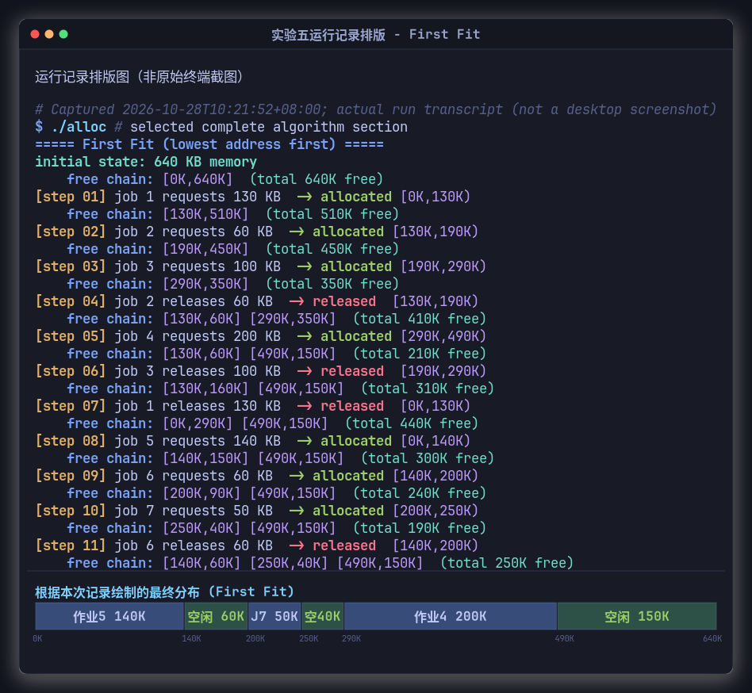
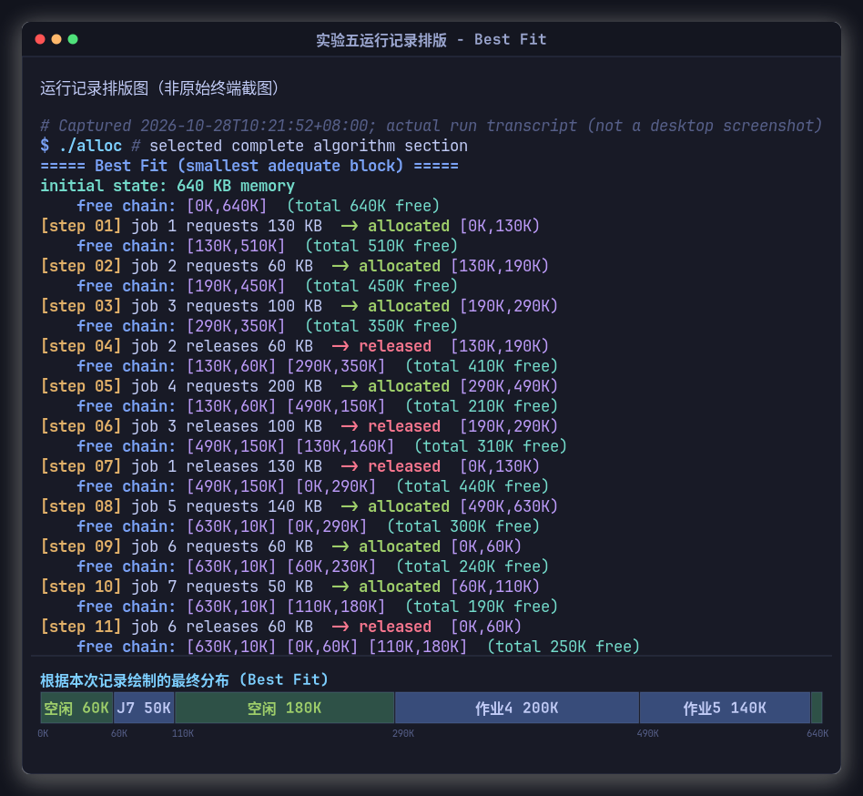

# 操作系统原理 实验报告

* **实验名称**：实验五：动态分区分配方式的模拟
* **姓名**：（填写姓名）　**学号**：（填写学号）　**日期**：2026-10-25
* **维护复测时间**：2026-11-26T19:44:23+08:00
* **复测环境**：Linux 7.3.5-2-cachyos x86_64 GNU/Linux；gcc (GCC) 16.2.1 20260810

> 图片为实际程序输出的排版图，非原始终端截图；内存分布示意图从本次记录推导，不冒充程序原生界面。提交时仍需本人终端原始截图及个人信息。

## 一、实验过程（20 分）

程序在 main 中用一次 `malloc(640 * 1024)` 申请模拟内存池，结束前用 `free()` 释放。首次适应和最佳适应先后复用同一块池，每次模拟开始时重置账目和池内容。分区地址采用 KB 偏移，实际起始位置对应 `pool + addr * 1024`；申请/回收仅在这块空间内标记，不向操作系统重新申请或释放作业分区。空闲链结点是单独申请的管理元数据，不计入被模拟的 640 KB。

首次适应的空闲链按地址升序，最佳适应按大小升序、同大小按地址升序。分配从空闲块低端切分，整块耗尽时摘除结点；最佳适应在分配后也重排，以免剩余块变小导致链序失效。回收前恢复地址序，插入并合并相邻块，再恢复所属算法要求的链序。起址处的分配长度记录用于拒绝越界、错误长度、非分区起址及重复释放。

按题目给定十一项请求分别运行两种算法，每次操作后打印空闲链。结束模拟时销毁所有剩余链结点，最终由 main 统一释放池。

## 二、实验详细操作步骤与程序清单（30 分）

在仓库根目录中执行：

```sh
make all
./build/lab5/alloc
make test                        # 包括独立参考推演、链序回归、边界和随机操作
make record
make reports
```

编译参数：`-std=gnu17 -Wall -Wextra -Wpedantic -Wconversion -Werror -O2 -g`。表格和输出中的 `[起址K,大小K]` 表示空闲链结点，而 `[起址K,结束地址K)` 表示分配/释放区间，二者含义不同。

### `src/lab5/alloc.c`

```c
/* 实验五：动态分区分配方式的模拟。
   用 malloc() 一次性申请 640KB 空间作为被管理的内存（此处用下标模拟地址，
   只做占用/空闲标记，并不真正向 OS 申请释放）。
   空闲分区用链表管理：
     - 首次适应(first fit)：空闲链按地址从小到大，分配时取第一个够用的块；
     - 最佳适应(best fit) ：空闲链按块大小从小到大，分配时取最小的够用块。
   分配时优先使用空闲块低端空间。回收时按地址插入并合并相邻空闲块。 */
#include <stdio.h>
#include <stdlib.h>
#include <string.h>

#define MEM_SIZE 640 /* 被管理内存总量 640KB */

/* 空闲分区结点 */
typedef struct fb
{
    int addr;        /* 分区起始地址(KB) */
    int size;        /* 分区大小(KB) */
    struct fb *next; /* 指向下一个空闲分区 */
} FB;

/* 分配器：head 指向空闲分区链，best=0 首次适应，best=1 最佳适应 */
typedef struct
{
    FB *head;
    int best;
    unsigned char *pool; /* main 一次申请；地址 addr 对应 pool + addr * 1024 */
    int allocated[MEM_SIZE]; /* 起址处记录已分配长度，用于拒绝错误/重复释放 */
} ALLOC;

static void resort(ALLOC *a, int by_size);

/* 初始化：整块 640KB 内存作为一个空闲分区 */
static int myinit(ALLOC *a, int best, unsigned char *pool)
{
    memset(a, 0, sizeof(*a));
    a->best = best;
    a->pool = pool;
    a->head = (FB *)malloc(sizeof(FB));
    if (a->head == NULL)
        return -1;
    a->head->addr = 0;
    a->head->size = MEM_SIZE;
    a->head->next = NULL;
    return 0;
}

/* 销毁管理结点；pool 的所有权在 main，最后只 free 一次。 */
static void mydestroy(ALLOC *a)
{
    while (a->head)
    {
        FB *next = a->head->next;
        free(a->head);
        a->head = next;
    }
}

/* 分配 size KB：成功返回起始地址，失败返回 -1。
   首次适应：取地址序中第一个 size 够用的块；
   最佳适应：在所有够用的块中取最小的。
   两种算法都从选中空闲块的低端切分。 */
static int mymalloc(ALLOC *a, int size)
{
    if (size <= 0 || size > MEM_SIZE)
        return -1;
    FB *prev = NULL, *cur = a->head;
    FB *pick = NULL, *pick_prev = NULL;

    while (cur)
    {
        if (cur->size >= size)
        {
            if (pick == NULL ||                       /* 第一个候选 */
                (a->best && cur->size < pick->size))  /* 最佳适应取更小者 */
            {
                pick = cur;
                pick_prev = prev;
                if (!a->best)
                    break; /* 首次适应：找到即止 */
            }
        }
        prev = cur;
        cur = cur->next;
    }
    if (pick == NULL)
        return -1; /* 没有足够大的空闲分区 */

    int addr = pick->addr; /* 从空闲块低端分配 */
    pick->addr += size;
    pick->size -= size;
    if (pick->size == 0) /* 整块用完则从链上摘除 */
    {
        if (pick_prev)
            pick_prev->next = pick->next;
        else
            a->head = pick->next;
        free(pick);
    }
    a->allocated[addr] = size;
    /* 真正的分区位于已申请的池中，不向 OS 再申请作业空间。 */
    memset(a->pool + (size_t)addr * 1024, 1, (size_t)size * 1024);
    if (a->best)
        resort(a, 1); /* 切分会改变大小，分配后也必须恢复最佳适应链序 */
    return addr;
}

/* 按地址从小到大把结点插入空闲链 */
static void insert_by_addr(ALLOC *a, FB *n)
{
    FB *prev = NULL, *cur = a->head;
    while (cur && cur->addr < n->addr)
    {
        prev = cur;
        cur = cur->next;
    }
    n->next = cur;
    if (prev)
        prev->next = n;
    else
        a->head = n;
}

/* 空闲链按指定关键字重排：by_size=1 按大小(最佳适应)，否则按地址 */
static void resort(ALLOC *a, int by_size)
{
    FB *sorted = NULL;
    while (a->head)
    {
        FB *n = a->head;
        a->head = n->next;
        FB *prev = NULL, *cur = sorted;
        while (cur && (by_size ?
               (cur->size < n->size || (cur->size == n->size && cur->addr < n->addr)) :
               cur->addr < n->addr))
        {
            prev = cur;
            cur = cur->next;
        }
        n->next = cur;
        if (prev)
            prev->next = n;
        else
            sorted = n;
    }
    a->head = sorted;
}

/* 回收起始地址 addr、大小 size 的分区：按地址插入，合并前后相邻空闲块 */
static int myfree(ALLOC *a, int addr, int size)
{
    if (addr < 0 || addr >= MEM_SIZE || size <= 0 || size > MEM_SIZE - addr ||
        a->allocated[addr] != size)
        return -1;
    /* 先申请结点，失败时保持原有分配状态和链序不变。 */
    FB *n = (FB *)malloc(sizeof(FB));
    if (n == NULL)
        return -1;
    /* 最佳适应的链平时按大小排序，先恢复地址序，插入合并才正确 */
    if (a->best)
        resort(a, 0);

    n->addr = addr;
    n->size = size;
    insert_by_addr(a, n);

    /* 合并地址相邻的空闲分区 */
    for (FB *cur = a->head; cur; cur = cur->next)
    {
        while (cur->next && cur->addr + cur->size == cur->next->addr)
        {
            FB *nb = cur->next;
            cur->size += nb->size;
            cur->next = nb->next;
            free(nb);
        }
    }
    if (a->best)
        resort(a, 1); /* 最佳适应：回收后重新按大小排序 */
    a->allocated[addr] = 0;
    memset(a->pool + (size_t)addr * 1024, 0, (size_t)size * 1024);
    return 0;
}

/* 打印当前空闲分区链 */
static void dump(ALLOC *a)
{
    int total = 0;
    printf("    free chain:");
    for (FB *p = a->head; p; p = p->next)
    {
        printf(" [%dK,%dK]", p->addr, p->size);
        total += p->size;
    }
    printf("  (total %dK free)\n", total);
}

/* 作业请求序列：op=1 申请，op=0 释放 */
struct step
{
    int job, op, size;
};
static struct step seq[] = {
    {1, 1, 130}, /* 作业 1 申请 130KB */
    {2, 1, 60},  /* 作业 2 申请 60KB  */
    {3, 1, 100}, /* 作业 3 申请 100KB */
    {2, 0, 60},  /* 作业 2 释放 60KB  */
    {4, 1, 200}, /* 作业 4 申请 200KB */
    {3, 0, 100}, /* 作业 3 释放 100KB */
    {1, 0, 130}, /* 作业 1 释放 130KB */
    {5, 1, 140}, /* 作业 5 申请 140KB */
    {6, 1, 60},  /* 作业 6 申请 60KB  */
    {7, 1, 50},  /* 作业 7 申请 50KB  */
    {6, 0, 60},  /* 作业 6 释放 60KB  */
};

/* 用指定算法跑一遍完整作业序列，每步打印空闲链 */
static int run(int best, unsigned char *pool)
{
    ALLOC a;
    int addr[8] = {0}, size[8] = {0}; /* 记录每个作业的分区(作业号 1..7) */

    printf("===== %s =====\n", best ? "Best Fit (smallest adequate block)" : "First Fit (lowest address first)");
    if (myinit(&a, best, pool) < 0)
    {
        perror("malloc free-list node");
        return 1;
    }
    memset(pool, 0, (size_t)MEM_SIZE * 1024);
    printf("initial state: %d KB memory\n", MEM_SIZE);
    dump(&a);

    size_t steps = sizeof(seq) / sizeof(seq[0]);
    for (size_t k = 0; k < steps; k++)
    {
        struct step *s = &seq[k];
        printf("[step %02zu] job %d %s %d KB", k + 1, s->job,
               s->op ? "requests" : "releases", s->size);
        if (s->op) /* 申请 */
        {
            int ad = mymalloc(&a, s->size);
            if (ad < 0)
            {
                printf("  -> FAILED: no adequate free block\n");
                mydestroy(&a);
                return 1;
            }
            else
            {
                addr[s->job] = ad;
                size[s->job] = s->size;
                printf("  -> allocated [%dK,%dK)\n", ad, ad + s->size);
            }
        }
        else /* 释放 */
        {
            if (myfree(&a, addr[s->job], size[s->job]) < 0)
            {
                fprintf(stderr, "invalid release or node allocation failed\n");
                mydestroy(&a);
                return 1;
            }
            printf("  -> released  [%dK,%dK)\n",
                   addr[s->job], addr[s->job] + size[s->job]);
            size[s->job] = 0;
        }
        dump(&a);
    }
    printf("\n");
    mydestroy(&a); /* 作业 4、5、7 仍占用；结束模拟时统一销毁管理账目 */
    return 0;
}

int main(void)
{
    unsigned char *pool = malloc((size_t)MEM_SIZE * 1024);
    if (pool == NULL)
    {
        perror("malloc 640KB pool");
        return 1;
    }
    int rc = run(0, pool); /* 首次适应算法 */
    if (rc == 0)
        rc = run(1, pool); /* 重置同一块内存，独立模拟最佳适应 */
    free(pool);
    return rc;
}
```

## 三、实验结果及分析（30 分）

### 1. 首次适应



关键步骤如下，完整十一项操作见 `text/lab5_first.txt`：

| 步骤 | 操作 | 操作后的空闲链（起址、大小） |
| --- | --- | --- |
| 03 | 作业3申请100K | [290K,350K] |
| 04 | 作业2释放60K | [130K,60K] [290K,350K] |
| 05 | 作业4申请200K | [130K,60K] [490K,150K] |
| 06 | 作业3释放100K | [130K,160K] [490K,150K] |
| 07 | 作业1释放130K | [0K,290K] [490K,150K] |
| 08 | 作业5申请140K | [140K,150K] [490K,150K] |
| 09 | 作业6申请60K | [200K,90K] [490K,150K] |
| 10 | 作业7申请50K | [250K,40K] [490K,150K] |
| 11 | 作业6释放60K | [140K,60K] [250K,40K] [490K,150K] |

作业4申请时低地址的60K不够，跳过后在290K起址处分配200K。步骤06、07连续回收使相邻空闲空间合并成290K。作业5、6、7从这个低地址块依次切分。最后作业6释放的区间两侧仍被占用，无法合并，空闲总量250K，最大连续空闲块150K。

### 2. 最佳适应



与首次适应的关键差异在步骤08之后，完整记录见 `text/lab5_best.txt`：

| 步骤 | 操作 | 分配/释放区间 | 操作后按大小排列的空闲链 |
| --- | --- | --- | --- |
| 07 | 作业1释放130K | [0K,130K) | [490K,150K] [0K,290K] |
| 08 | 作业5申请140K | [490K,630K) | [630K,10K] [0K,290K] |
| 09 | 作业6申请60K | [0K,60K) | [630K,10K] [60K,230K] |
| 10 | 作业7申请50K | [60K,110K) | [630K,10K] [110K,180K] |
| 11 | 作业6释放60K | [0K,60K) | [630K,10K] [0K,60K] [110K,180K] |

步骤08选择最小够用的150K块，留下10K。最终空闲总量仍为250K，但最大连续块为180K。10K无法服务本序列随后60K和50K的请求，不过可用于未来不超过10K的申请，并非永久不可用。

### 3. 对比与验证

两种算法在给定序列中均无分配失败，最终作业4、5、7仍占用390K，并非所有作业都已释放。本例最佳适应虽留下10K小块，但保留了比首次适应更大的最大连续块（180K 对 150K），不能据一个小块就断言它整体更差，也不能由单一序列推导普遍性能优劣。

相邻合并能恢复连续空闲空间；未合并的块可能地址相邻而仅在链中分开，不能称为“互不相邻”。题目200K请求发生在步骤05，不能声称它在步骤06、07之后失败。应根据实际请求序列或另行验证的扩展实验讨论碎片影响。

本次测试逐项将两种算法的十二个状态（初态及十一项操作）与独立参考实现对照。另实际复现并修复了排序回归：最佳适应申请100K三次、释放起址0的100K、再从高地址340K块申请300K后，链必须按 `[600K,40K] [0K,100K]` 排列。测试还覆盖整池申请、耗尽、零/负数/越界申请、错误和重复释放、完全合并，以及两种算法共2000次固定种子操作；每次核对无重叠、总量守恒、链序和池标记。

## 四、疑难小结（20 分）

1. 原实现只创建了空闲链，没有真正申请640KB内存池；本次补上池的申请、标记、复用和释放，代码才与题目及文字描述一致。
2. 原最佳适应仅在回收后重排，分配切分同样会改变大小；新增独立回归用例后，分配后也重排。只跑题目固定序列不足以暴露所有不变量问题。
3. 分配长度记录和调用方的作业映射用途不同：前者验证回收合法性，后者记录作业号对应的起址和长度。模拟结束销毁账目并释放池，不需要虚构序列中没有要求的作业释放操作。
4. 本次补上内存申请失败检查和链表结点销毁；测试与源码检查不等于已通过 ASan/泄漏检测器。本节只记录本次实际发现及验证的问题，不补写未经核实的历史调试过程。
